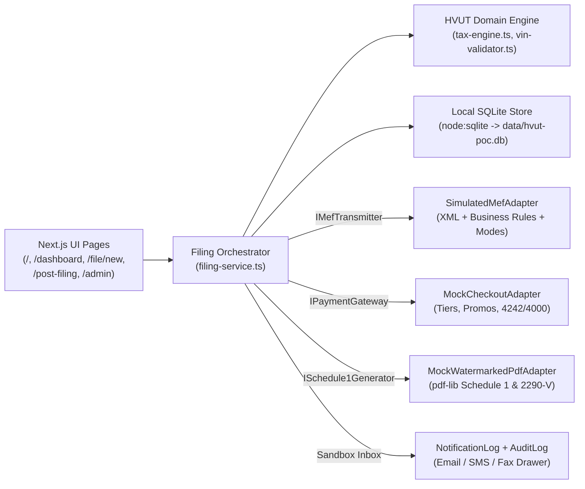
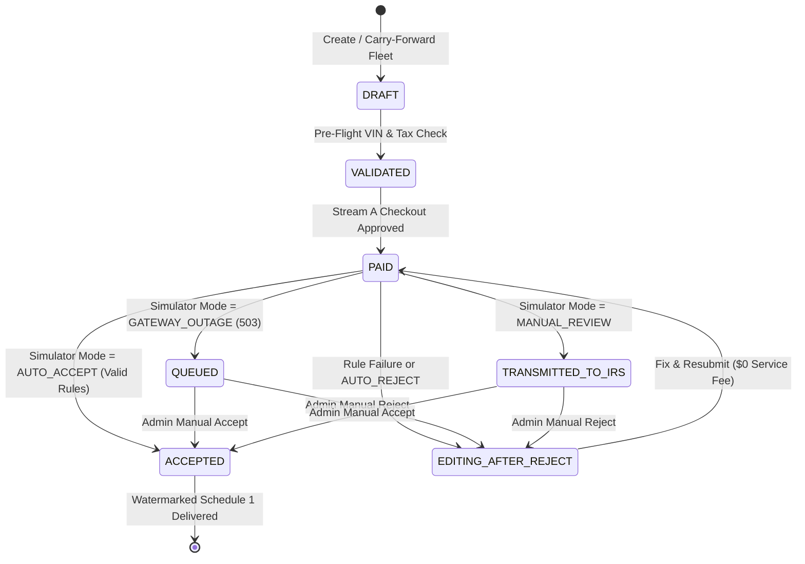

# IRS Form 2290 (HVUT) PoC Application — Functional Understanding Guide

**Workspace:** `d:\IRS HVUT`  
**Related Spec:** [form_2290_hvut_requirements_spec.md](file:///d:/IRS%20HVUT/form_2290_hvut_requirements_spec.md)  
**Quick Start:** [README.md](file:///d:/IRS%20HVUT/README.md)

---

## 1. Purpose & High-Level Architecture

This Proof-of-Concept (PoC) web application simulates the entire **IRS Form 2290 (Heavy Highway Vehicle Use Tax)** e-filing ecosystem locally—without needing an active IRS **EFIN**, **ETIN**, **Software ID**, or **Assurance Testing System (ATS)** access.

The application uses a **Ports & Adapters** architecture so that all domain rules (tax calculation, VIN/EIN validation, filing state machine, two-stream payments) operate identically to production while external services are locally simulated:

### Key Design Principle for Production Transition
When IRS authorization and third-party vendor credentials are ready, only the adapter implementations in `src/lib/adapters/` need to be swapped:
- `SimulatedMefAdapter` → IRS MeF SOAP/MTOM client (or authorized MeF transmitter API)
- `MockWatermarkedPdfAdapter` → IRS MeF acknowledgment Schedule 1 PDF extractor
- `MockCheckoutAdapter` → Stripe / Braintree PCI-tokenized checkout
- `NotificationLog` → SendGrid (Email), Twilio (SMS), and eFax/Phaxio (Fax)

---

## 2. Filing Lifecycle State Machine

Every return (`ReturnFiling`) moves through the same lifecycle defined in the SRS, managed across the Wizard, Filing Service, and Admin Simulator Console:

---

## 3. Pre-Seeded Personas & Demo Data

On first startup, [db.ts](file:///d:/IRS%20HVUT/src/lib/hvut/db.ts) initializes `data/hvut-poc.db` (via Node 24's built-in `node:sqlite`) and seeds four personas selectable from the top **Persona Quick-Switcher** in [AppShell.tsx](file:///d:/IRS%20HVUT/src/components/AppShell.tsx):

| Persona | User ID | Role | Pre-Seeded Businesses (EINs) | Purpose in PoC |
| :--- | :--- | :--- | :--- | :--- |
| **Mike Carter** | `usr-owner` | `OWNER_OP` | `MIKES HAULING LLC` (`47-1234567`) | Single-truck owner-operator with a prior-year (`2025-2026`) accepted return (`FIL-2025-1001`) ready for carry-forward. |
| **Elena Rostova** | `usr-fleet` | `FLEET` | `SUMMIT FREIGHT CARRIERS INC` (`82-4455661`) | Fleet manager with 3 active trucks (2 Category V taxable + 1 Category W suspended) and an accepted `2026-2027` filing (`FIL-2026-2001`). |
| **Sarah Chen, CPA** | `usr-cpa` | `CPA` | `REDWOOD TIMBER LOGGING CO` (`36-7788990`) & `HEARTLAND AG TRANSPORT LLC` (`54-3322110`) | Tax preparer managing multiple client EINs under one account, including a logging vehicle (`LOG-09`) eligible for the 25% logging discount. |
| **Platform Admin** | `usr-admin` | `ADMIN` | Visibility across all businesses | Operations & Simulator Console access to control MeF modes, manually accept/reject submissions, and inspect audit logs. |

---

## 4. Screen-by-Screen Functional Walkthrough

### 4.1 Public HVUT Tax Calculator (`/`)
File: [page.tsx](file:///d:/IRS%20HVUT/src/app/page.tsx) | Logic: [tax-engine.ts](file:///d:/IRS%20HVUT/src/lib/hvut/tax-engine.ts)

- **Unauthenticated Access:** Lets prospective users estimate IRS tax due before paying or filing.
- **Weight Categories (`A`–`W`):**
  - Category `A` (55,000 lbs): **\$100/yr**
  - Categories `B`–`U`: **+\$22** per additional 1,000 lbs (up to \$540/yr for `U`)
  - Category `V` (>75,000 lbs): **\$550/yr** cap
  - Category `W` (Suspended: ≤ 5,000 commercial miles or ≤ 7,500 agricultural miles): **\$0/yr** (still requires Schedule 1 filing)
- **Logging Vehicle Toggle:** Applies a **25% tax reduction** (75% of standard rate) across categories `A`–`V`.
- **Monthly Proration:** For vehicles first used after July, computes:
  $$\text{Prorated Tax} = \text{Full Annual Tax} \times \frac{\text{Remaining Months (inclusive of First-Use Month)}}{12}$$
- **Statutory Deadline Display:** Computes `August 31` for July first use, or the last day of the month following the first-use month for mid-year additions.

---

### 4.2 Business Dashboard & Document Vault (`/dashboard`)
File: [dashboard/page.tsx](file:///d:/IRS%20HVUT/src/app/dashboard/page.tsx)

- **Multi-EIN Switcher:** Switch between legal entities owned by the active persona (or all entities when signed in as Admin).
- **Add EIN Modal:** Creates a new `BusinessEntity` via `POST /api/businesses`, validating a 9-digit EIN (rejecting repeating digits or SSN-like prefixes `00`/`66`) and auto-deriving the 4-character **IRS Name Control** (`deriveNameControl`).
- **Carry-Forward Fleet:** Clicking **Carry-Forward Fleet** invokes `POST /api/businesses/[id]/carry-forward`, cloning all `ACTIVE` vehicles from the business's fleet roster into a new `2026-2027` draft return and opening it directly in the filing wizard.
- **Document Vault & Actions:**
  - **Schedule 1 PDF:** Downloads the dynamically generated, watermarked Schedule 1 PDF (`GET /api/filings/[id]/schedule1`) for `ACCEPTED` returns.
  - **2290-V Voucher:** Downloads the Form 2290-V payment voucher PDF (`GET /api/filings/[id]/voucher`) when `CHECK` is selected.
  - **View MeF XML:** Opens an inline XML viewer showing the exact IRS-structured `<Return>` payload generated for the submission.
  - **Fix & Resubmit (\$0 Fee):** Re-opens `EDITING_AFTER_REJECT` returns in the wizard with human-readable rejection guidance and waives the Stream A service fee on resubmission.

---

### 4.3 Form 2290 Original Return Wizard (`/file/new`)
File: [file/new/page.tsx](file:///d:/IRS%20HVUT/src/app/file/new/page.tsx)

A 5-step guided workflow enforcing **Prepare Free, Pay to File**:

1. **Step 1 — Business & Tax Period:** Choose business/EIN, tax year (`2026-2027` or `2025-2026`), month of first use, and special flags (*Address Change*, *Final Return*).
2. **Step 2 — Vehicles & Bulk CSV Import:**
   - Add vehicles manually, click the **Sparkles** icon to auto-generate a mathematically valid test VIN (`generateValidTestVin`), or download and upload a **CSV fleet template**.
   - **Pre-Flight Validation ([vin-validator.ts](file:///d:/IRS%20HVUT/src/lib/hvut/vin-validator.ts)):** Checks 17 alphanumeric characters, prohibits `I`, `O`, and `Q`, detects duplicate VINs within the same return, and verifies the **ISO 3779 check digit** (with an optional soft-override checkbox for legacy pre-1981 VINs). Invalid CSV rows highlight inline for immediate editing without re-uploading.
   - Supports **Taxable**, **Suspended (Category W)**, and **Credit Vehicles** (offsetting current tax due).
3. **Step 3 — Stream B (IRS Tax Payment Method):**
   - `EFW`: Electronic Funds Withdrawal (captures bank routing/account + Checking/Savings).
   - `EFTPS`: Electronic Federal Tax Payment System declaration.
   - `CARD`: IRS-authorized third-party card processor notice.
   - `CHECK`: Check or Money Order (enables Form 2290-V PDF generation).
4. **Step 4 — Stream A (Platform Service Fee Checkout) & E-Signature:**
   - Calculates tiered service fees ([payment-simulator.ts](file:///d:/IRS%20HVUT/src/lib/adapters/payment-simulator.ts)):
     - 1 Vehicle: **\$7.99** | 2–5: **\$19.99** | 6–25: **\$49.99** | 26–100: **\$99.99** | 101+: **\$149.99**
     - Unlimited Annual Plan toggle: **\$0** base fee
     - Free Resubmission after IRS rejection: **\$0** total
   - Supports promo codes (`TRUCK10` = 10% off, `FLEET25` = \$25 off, `POCFREE` = 100% off), SMS alerts (+\$1.99), Fax delivery (+\$2.99), and a **5-digit Self-Select E-Signature PIN**.
5. **Step 5 — Simulated MeF Transmission Result:** Displays `ACCEPTED`, `EDITING_AFTER_REJECT`, `TRANSMITTED_TO_IRS`, or `QUEUED` along with Schedule 1 / 2290-V PDF links and raw MeF XML inspection.

---

### 4.4 Post-Filing Suite (`/post-filing`)
File: [post-filing/page.tsx](file:///d:/IRS%20HVUT/src/app/post-filing/page.tsx)

1. **Form 2290 — VIN Correction (`2290_VIN_CORR`):** Maps an incorrect prior VIN from an accepted return to a corrected 17-character VIN (**\$0.00** service fee for returns originally filed on the platform).
2. **Form 2290 — Amended Return (`2290_AMEND`, \$19.99):**
   - *Weight Increase:* Computes incremental tax $(\text{New Prorated Tax} - \text{Prior Prorated Tax})$ from the month of weight increase through June 30.
   - *Mileage Exceeded:* Converts a Category `W` suspended vehicle to a taxable category (`A`–`V`).
3. **Form 8849 Schedule 6 (`8849_SCH6`, \$19.99):** Submits refund claims for `SOLD`, `DESTROYED`, `STOLEN`, or `LOW_MILEAGE` vehicles.

---

### 4.5 Admin & IRS MeF Simulator Console (`/admin`)
File: [admin/page.tsx](file:///d:/IRS%20HVUT/src/app/admin/page.tsx)

- **Gateway Behavior Modes:**
  - `AUTO_ACCEPT`: Valid submissions are accepted immediately with a Schedule 1 PDF.
  - `MANUAL_REVIEW`: Submissions pause at `TRANSMITTED_TO_IRS` until an admin clicks **Accept & Issue Schedule 1** or **Reject** with a chosen IRS error code.
  - `AUTO_REJECT`: Forces all submissions to reject with the configured IRS error code.
  - `GATEWAY_OUTAGE`: Simulates HTTP `503` IRS maintenance; submissions stay in `QUEUED` status.
- **IRS Rejection Resolution Dictionary:** Lists simulated IRS codes (`F2290-001`, `F2290-023`, `F2290-011`, `R0000-905`, `R0000-500`, `GATEWAY-503`) and their user-facing fix instructions.
- **Immutable Audit Log & Reset:** Displays every system/user/admin action and provides a **Reset & Reseed Demo Data** button.

---

### 4.6 Sandbox Delivery Inbox (`AppShell`)
File: [AppShell.tsx](file:///d:/IRS%20HVUT/src/components/AppShell.tsx)

Every filing state transition logs simulated `EMAIL` (with direct Schedule 1 PDF attachment links), `SMS`, and `FAX` records into SQLite. Clicking **Sandbox Inbox** in the top navigation bar opens a slide-over drawer showing all delivered messages and marks them as read.

---

## 5. Built-In QA & Validation Test Triggers

Use these deterministic inputs to test every happy path and failure scenario in the PoC:

| Scenario to Test | How to Trigger | Expected Outcome |
| :--- | :--- | :--- |
| **Happy Path Acceptance** | Default `AUTO_ACCEPT` mode, card `4242...`, valid business & VIN | Status `ACCEPTED`, watermarked Schedule 1 PDF generated, Email/SMS added to Sandbox Inbox. |
| **Card Decline (Stream A)** | Enter card starting with `4000...` in Step 4 | HTTP `402` error; payment `DECLINED`; return is **not** transmitted to MeF. |
| **EIN / Name Control Mismatch (`F2290-001`)** | Create a business with Name Control `BAD1` or EIN ending in `99` | Rejected with `F2290-001`; status moves to `EDITING_AFTER_REJECT`; next resubmit costs **\$0**. |
| **New EIN / EFIN Error (`R0000-905`)** | Use a business with EIN ending in `88` | Rejected with `R0000-905` (simulates new EIN not yet propagated in IRS MeF). |
| **Duplicate VIN (`F2290-023`)** | Submit a `2290_ORIG` return containing a VIN already `ACCEPTED` for that EIN & tax year | Rejected with `F2290-023` explaining the VIN was already reported. |
| **CSV Inline Error Repair** | Download **Sample CSV** in Step 2 and re-upload it | Row 3 (`1FUJGLD50NL12345O`) is flagged inline for containing forbidden letter `O`; fix inline with Sparkles button. |
| **Manual IRS Review Flow** | Switch to `MANUAL_REVIEW` in `/admin`, submit a return, then approve/reject in `/admin` | Return pauses in `TRANSMITTED_TO_IRS`, then transitions upon admin decision. |
| **IRS Maintenance Window** | Switch to `GATEWAY_OUTAGE` in `/admin` and submit a return | Return stays in `QUEUED` with `GATEWAY-503` alert notification. |

---

## 6. Backend API Endpoints Reference

| Method & Route | Purpose |
| :--- | :--- |
| `GET /api/bootstrap` | Loads users, businesses, vehicles, filings, notifications, audit logs, and simulator config. |
| `POST /api/businesses` | Creates or updates a `BusinessEntity` with EIN and Name Control validation. |
| `POST /api/businesses/[id]/carry-forward` | Clones active fleet vehicles into a new `DRAFT` filing for the target tax year. |
| `GET /api/filings`, `POST /api/filings` | Lists filings (optionally filtered by `businessId`) or saves/updates a draft/validated filing. |
| `POST /api/filings/[id]/checkout-submit` | Runs Stream A checkout, saves Stream B tax payment metadata, transmits to `SimulatedMefAdapter`, and dispatches notifications. |
| `POST /api/filings/[id]/simulate-decision` | Admin endpoint to manually `ACCEPT` or `REJECT` a pending filing. |
| `GET /api/filings/[id]/schedule1` | Streams the generated, watermarked Schedule 1 PDF (`application/pdf`). |
| `GET /api/filings/[id]/voucher` | Streams the generated Form 2290-V Payment Voucher PDF (`application/pdf`). |
| `POST /api/notifications/read` | Marks all Sandbox Inbox notifications as read. |
| `GET /api/simulator`, `PATCH /api/simulator` | Reads or updates `SimulatorConfig`, or resets & reseeds the SQLite database (`{"action":"RESET"}`). |

