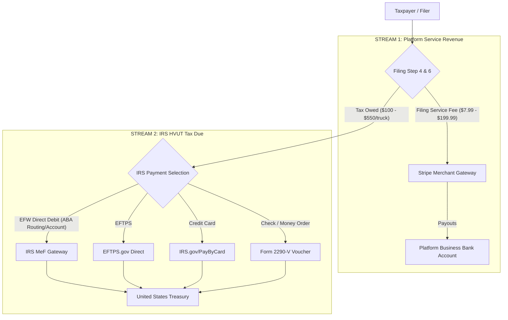
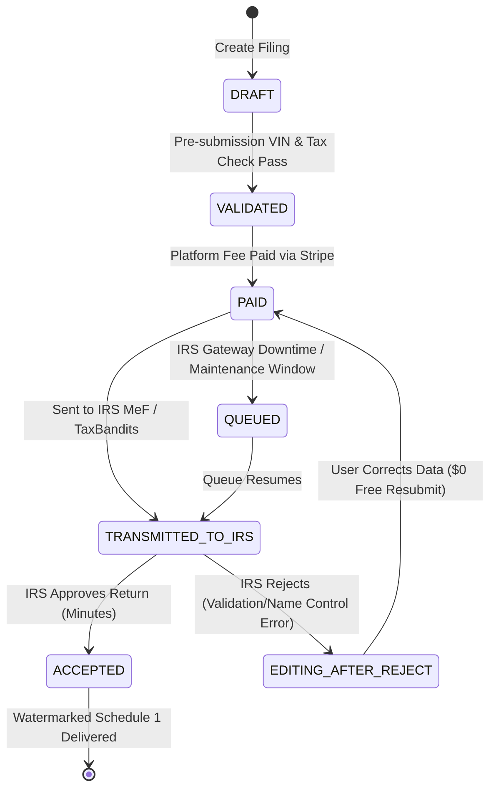

# Functional Requirement Specifications (FRS)
## IRS Form 2290 (HVUT) Commercial E-Filing Web Application

**Document Version:** 2.0 (Production Outsourcing Specification)  
**Target Project:** IRS Form 2290 Heavy Highway Vehicle Use Tax (HVUT) SaaS Platform  
**Target Audience:** Software Development Vendor, Business Analysts, System Architects, QA Engineers, Product Owners  
**Classification:** Confidential / Commercial Software Procurement Specification  

---

## Table of Contents
1. [Executive Summary & Business Objectives](#1-executive-summary--business-objectives)
2. [IRS Form 2290 Regulatory Domain Rules](#2-irs-form-2290-regulatory-domain-rules)
3. [User Personas & Role-Based Access Control (RBAC)](#3-user-personas--role-based-access-control-rbac)
4. [Functional Modules & Detailed User Stories](#4-functional-modules--detailed-user-stories)
   - [Module 1: Authentication, Onboarding & Security](#module-1-authentication-onboarding--security)
   - [Module 2: Business Profile & Multi-EIN Management](#module-2-business-profile--multi-ein-management)
   - [Module 3: Fleet Roster & Vehicle Management](#module-3-fleet-roster--vehicle-management)
   - [Module 4: Standalone Public Tax Calculator](#module-4-standalone-public-tax-calculator)
   - [Module 5: End-to-End 8-Step E-File Wizard](#module-5-end-to-end-8-step-e-file-wizard)
   - [Module 6: Two-Stream Payment System](#module-6-two-stream-payment-system)
   - [Module 7: Dashboard, Tracking & Document Retrieval](#module-7-dashboard-tracking--document-retrieval)
   - [Module 8: Free VIN Correction & IRS Rejection Handling](#module-8-free-vin-correction--irs-rejection-handling)
   - [Module 9: Multi-Channel Automated Notification Engine](#module-9-multi-channel-automated-notification-engine)
   - [Module 10: Administrative Console & Operations Portal](#module-10-administrative-console--operations-portal)
5. [Business Workflows & State Machines](#5-business-workflows--state-machines)
6. [Acceptance Criteria & Non-Functional Requirements](#6-acceptance-criteria--non-functional-requirements)

---

## 1. Executive Summary & Business Objectives

### 1.1 Purpose
The purpose of this project is to build an enterprise-grade, cloud-based, IRS-authorized **Form 2290 (Heavy Highway Vehicle Use Tax - HVUT)** e-filing platform. The platform enables owner-operators, commercial trucking fleets, and Certified Public Accountants (CPAs) to prepare, calculate, pay service fees for, and transmit tax returns to the IRS, receiving the official IRS watermarked **Schedule 1** proof of payment in real time.

### 1.2 Core Business Model ("Prepare Free, Pay to Submit")
1. **Zero Upfront Cost:** Taxpayers can register, set up business entities, add vehicles, and view tax computations without paying.
2. **Platform Monetization:** Users pay a platform service fee at checkout (ranging from \$7.99 for single vehicles to tiered fleet packages or \$199.99 unlimited annual subscriptions).
3. **Free Value-Add:** Free electronic VIN corrections for returns originally filed on the platform, and \$0 resubmissions on IRS rejections.
4. **Schedule 1 Delivery:** Instant delivery of IRS watermarked Schedule 1 via online dashboard download, email PDF, and optional SMS/fax dispatch to State DMVs.

---

## 2. IRS Form 2290 Regulatory Domain Rules

The vendor **must strictly implement** the statutory tax laws governed by Title 26 of the United States Code (Internal Revenue Code) and IRS Form 2290 instructions:

### 2.1 Tax Period & Statutory Deadlines
- **Tax Year Period:** The tax year always spans **July 1 through June 30** of the following calendar year (e.g., `2026-2027`).
- **Month of First Use (FUM):** The calendar month during the tax period in which a vehicle is first operated on public highways.
- **Annual Due Date:** For vehicles first used in July, the annual statutory filing and tax payment deadline is **August 31**.
- **Mid-Year Additions:** For vehicles placed in service after July, the return must be filed and taxes paid by the **last day of the month following the Month of First Use**. (Example: A truck first used in October must be filed by November 30).
- **Sunday/Holiday Rollover:** If a due date falls on a Saturday, Sunday, or federal legal holiday, the deadline shifts to the next business day.

### 2.2 Vehicle Weight Categories & Tax Calculations
Vehicles with a taxable gross weight of **55,000 lbs or more** are subject to HVUT.

| Category | Taxable Gross Weight Range (lbs) | Annual Standard Tax | Annual Logging Tax (25% Discount) |
| :---: | :---: | :---: | :---: |
| **A** | 55,000 | \$100.00 | \$75.00 |
| **B** | 55,001 – 56,000 | \$122.00 | \$91.50 |
| **C** | 56,001 – 57,000 | \$144.00 | \$108.00 |
| **D** | 57,001 – 58,000 | \$166.00 | \$124.50 |
| **E** | 58,001 – 59,000 | \$188.00 | \$141.00 |
| **F** | 59,001 – 60,000 | \$210.00 | \$157.50 |
| **G** | 60,001 – 61,000 | \$232.00 | \$174.00 |
| **H** | 61,001 – 62,000 | \$254.00 | \$190.50 |
| **I** | 62,001 – 63,000 | \$276.00 | \$207.00 |
| **J** | 63,001 – 64,000 | \$298.00 | \$223.50 |
| **K** | 64,001 – 65,000 | \$320.00 | \$240.00 |
| **L** | 65,001 – 66,000 | \$342.00 | \$256.50 |
| **M** | 66,001 – 67,000 | \$364.00 | \$273.00 |
| **N** | 67,001 – 68,000 | \$386.00 | \$289.50 |
| **O** | 68,001 – 69,000 | \$408.00 | \$306.00 |
| **P** | 69,001 – 70,000 | \$430.00 | \$322.50 |
| **Q** | 70,001 – 71,000 | \$452.00 | \$339.00 |
| **R** | 71,001 – 72,000 | \$474.00 | \$355.50 |
| **S** | 72,001 – 73,000 | \$496.00 | \$372.00 |
| **T** | 73,001 – 74,000 | \$518.00 | \$388.50 |
| **U** | 74,001 – 75,000 | \$540.00 | \$405.00 |
| **V** | Over 75,000 lbs | **\$550.00** (Statutory Cap) | **\$412.50** |
| **W** | Suspended (Under Mileage Limit) | **\$0.00** | **\$0.00** |

#### Prorated Tax Formula
For vehicles first used after July, tax is prorated for the remaining months in the tax period:
$$\text{Tax Due} = \text{Annual Tax} \times \frac{M}{12}$$
Where $M$ is the number of months remaining from the First Used Month through June 30:
- July = 12 months, August = 11 months, ..., June = 1 month.

### 2.3 Category W: Suspended (Tax-Exempt Mileage) Vehicles
- **Commercial Highway Vehicles:** Expected to be driven **5,000 miles or less** during the tax year.
- **Agricultural Vehicles:** Used primarily for farming operations, expected to be driven **7,500 miles or less**.
- Suspended vehicles pay **\$0.00** tax but **must be reported on Form 2290** to receive an official IRS-stamped Schedule 1 for state vehicle registration.

### 2.4 Tax Credits & Form 8849 (Schedule 6)
Filers can claim tax credits against current taxes or request direct refunds for:
1. **Low Mileage Exemption:** Taxes previously paid on a vehicle that was driven 5,000 miles or less (7,500 for agricultural) in the prior tax year.
2. **Sold, Destroyed, or Stolen:** Prorated refund for vehicles disposed of before the end of the tax period.
3. **Overpayment:** Errors in prior filings resulting in excess tax paid.

### 2.5 Form 2290 Amendments
1. **Taxable Gross Weight Increase:** When a vehicle increases in gross weight category mid-year, tax due is the prorated difference between the old and new category taxes.
2. **Mileage Limit Exceeded:** When a vehicle declared as suspended (Category W) exceeds 5,000 miles (or 7,500 miles), the full tax becomes immediately due from the first-used month.

### 2.6 Native VIN Corrections
Typographical errors on accepted Schedule 1s (e.g., character transposition) must be submitted electronically as a **Form 2290 VIN Correction**, providing the original erroneous VIN, the corrected 17-character VIN, and the original Schedule 1 date.

---

## 3. User Personas & Role-Based Access Control (RBAC)

| Role | Target Persona | Primary Responsibilities & Functional Scope |
| :--- | :--- | :--- |
| **OWNER_OP** | Individual Truck Owner (1–5 trucks) | Registers, inputs single business EIN, uses step-by-step wizard, files single Form 2290, pays with card/Stripe, downloads stamped Schedule 1. |
| **FLEET** | Fleet Operations Manager (25–500+ trucks) | Manages large fleet, bulk uploads CSV vehicle inventories, uses fleet carry-forward year-over-year, purchases unlimited subscription tiers. |
| **CPA** | Tax Preparer / Accounting Agency | Manages multiple client businesses under one login, switches client context in 1-click, inputs client EFW banking info, generates consolidated billing. |
| **ADMIN** | Platform Super-Admin & Support | Monitors IRS MeF transmission pipeline, resolves stuck returns, overrides/re-transmits filings, manages promo codes, views platform financial metrics. |

---

## 4. Functional Modules & Detailed User Stories

### Module 1: Authentication, Onboarding & Security
- **REQ-AUTH-001 (Registration):** User registers with First Name, Last Name, Email, Mobile Phone, and secure Password (min 8 chars, 1 uppercase, 1 number, 1 special character).
- **REQ-AUTH-002 (MFA / 2FA):** Mandatory or optional Multi-Factor Authentication via SMS OTP or Time-based OTP (TOTP/Google Authenticator).
- **REQ-AUTH-003 (Role Assignment):** User chooses account type (`Owner Operator`, `Fleet Manager`, or `Tax Preparer / CPA`).
- **REQ-AUTH-004 (Session & Password Recovery):** Secure JWT or server-side session management with expiring password reset links.

### Module 2: Business Profile & Multi-EIN Management
- **REQ-BIZ-001 (EIN Validation):** System accepts only valid 9-digit Federal Employer Identification Numbers (`XX-XXXXXXX`). Individual SSNs are strictly rejected.
- **REQ-BIZ-002 (IRS Name Control Generation):** System automatically calculates and recommends the official 4-character **IRS Name Control** (e.g., *"SMITH TRUCKING LLC"* &rarr; `SMIT`), with an override option for filers who have IRS correspondence showing an alternate name control.
- **REQ-BIZ-003 (Business Details):** Captures Legal Business Name, DBA (optional), Business Address (Physical and Mailing, Suite/Unit), Signing Authority Name, Signing Authority Title, Contact Phone, and Email.
- **REQ-BIZ-004 (Multi-Business Context Switcher):** CPAs and Fleet Managers can create, edit, and switch between dozens of client businesses in a single dropdown.

### Module 3: Fleet Roster & Vehicle Management
- **REQ-FLT-001 (Vehicle Roster CRUD):** Maintain a persistent database of fleet vehicles per business entity, including VIN, Unit/Truck Number, Default Weight Category (A–V, W), and Logging/Agricultural flags.
- **REQ-FLT-002 (VIN Validation Engine):**
  - Must be exactly 17 alphanumeric characters.
  - Strictly disallow letters `I`, `O`, and `Q` (per standard ISO 3779).
  - Compute ISO 3779 9th-digit mathematical check digit (alerting users to invalid VINs).
- **REQ-FLT-003 (Bulk CSV Import):** Upload hundreds of vehicles simultaneously using a downloadable CSV template. Validates every row and presents an interactive error grid for correcting invalid VINs prior to import.
- **REQ-FLT-004 (Annual Fleet Carry-Forward):** 1-click feature on the dashboard allowing fleet managers to carry forward their active fleet from `2025-2026` to `2026-2027` with automated first-used month assignment.

### Module 4: Standalone Public Tax Calculator
- **REQ-CALC-001 (Public Access):** Accessible without authentication at `/tax-calculator` for marketing and lead generation.
- **REQ-CALC-002 (Interactive Computation):** Select Tax Period, First Used Month, Weight Category, and Logging status. Dynamically computes the exact prorated tax due and highlights statutory IRS filing deadlines.

### Module 5: End-to-End 8-Step E-File Wizard
The core user workflow is structured as an intuitive, state-preserved 8-step wizard:

1. **Step 1: Get Started**
   - Select Form Type: `Form 2290 Original`, `Form 2290 Amendment`, `Form 2290 VIN Correction`, or `Form 8849 Schedule 6`.
   - Select Tax Year (e.g., `2026-2027`).
   - Checkbox options: Address Change, Final Return (going out of business).

2. **Step 2: Tax Period & First Used Month**
   - Select Month of First Use (July through June).
   - Display calculated statutory filing deadline and countdown alert.

3. **Step 3: Vehicle Information Entry**
   - Interactive vehicle table with tabs for: `Taxable Vehicles`, `Suspended (Category W)`, `Prior Year Suspended`, `Credit Vehicles`, and `VIN Corrections`.
   - Single add modal or bulk CSV upload.
   - Dynamic real-time calculation of gross tax, credits, and net tax balance.

4. **Step 4: IRS Filing & Payment Options (Stream 2)**
   - E-File vs. Paper File election (defaults to e-file).
   - Third-Party Designee authorization (IRS checkbox to permit representative discussion).
   - Selection of IRS Tax Payment Method:
     * **EFW (Direct Debit):** 9-digit ABA Routing Number with live checksum validation, Bank Account Number, Confirm Account Number, Account Type (Checking/Savings), Debit Date, and mandatory IRS EFW Consent disclosure.
     * **EFTPS:** Guidance notice and deep-link to `EFTPS.gov`.
     * **Credit/Debit Card:** Guidance notice, 2-payment-per-period limit rule, and deep-link to official IRS Card Portal (`IRS.gov/PayByCard`).
     * **Check or Money Order:** Generates official populated **Form 2290-V Payment Voucher PDF** with IRS mailing addresses.

5. **Step 5: Platform Service Pricing & Add-Ons (Stream 1)**
   - Transparent pricing display:
     * Per-Vehicle tier (e.g. 1 vehicle = \$7.99, 2–4 = \$19.99, 5–9 = \$29.99, etc.).
     * Unlimited Single Return package (\$139.99).
     * Unlimited Annual Enterprise Package (\$199.99).
   - Value-added add-on selections:
     * Instant Fax of Schedule 1 to DMV/DOT (\$1.00).
     * SMS Status Alert (\$1.00).
     * Additional Email CC recipients.
   - Promotional discount code field (`PROMO_CODE`) with real-time recalculation.

6. **Step 6: Platform Checkout Page**
   - **Stripe Express Checkout:** 1-click button for Apple Pay, Google Pay, Link, and Cards via Stripe Hosted Session.
   - **Embedded Card Form:** Direct entry of Cardholder Name, Card Number, Expiration Date, CVV, and Billing Address.
   - Displays complete order itemization, fees, discounts, and final total.

7. **Step 7: Summary Review & Digital PIN Signature**
   - Comprehensive summary review sheet of all vehicles, categories, tax liabilities, and payment methods.
   - Downloadable Draft PDF summary for customer sign-off.
   - Electronic Signature modal: Captures 5-digit self-select PIN (cannot be `00000`) and authorized signer acknowledgment under penalties of perjury.

8. **Step 8: Submission Confirmation & Live Tracking**
   - Immediate display of IRS Submission ID.
   - Real-time status tracker (Processing &rarr; Transmitted &rarr; Accepted / Rejected).
   - 1-click access to download Form 2290 Draft, Form 2290-V Voucher, and official IRS Stamped Schedule 1 upon acceptance.

---

### Module 6: Two-Stream Payment System

The software must maintain strict physical, logical, and accounting separation between:

---

### Module 7: Dashboard, Tracking & Document Retrieval
- **REQ-DASH-001 (Filings Table):** Filterable list showing Tax Year, Form Type, Business Name, Filing ID, Vehicle Count, Submission Date, Filing Status, and Actions.
- **REQ-DASH-002 (Real-Time Status Polling):** Interactive **"Sync Status"** button enabling filers to ping the IRS MeF gateway on demand without waiting for background cron cycles.
- **REQ-DASH-003 (Document Downloads):**
  - **Schedule 1 (Official Watermarked PDF):** Available within minutes of IRS acceptance, showing official IRS e-file digital watermark.
  - **Form 2290 Copy:** Full 6-page filled tax return.
  - **Form 2290-V Voucher:** Populated with check mailing instructions.
  - **Platform Payment Receipt:** Printable billing receipt for business expense write-offs.
- **REQ-DASH-004 (MeF XML Viewer):** Technical inspection modal allowing CPAs and power users to inspect the raw validated IRS MeF XML payload.

---

### Module 8: Free VIN Correction & IRS Rejection Handling
- **REQ-REJ-001 (Rejection Code Translation):** When a return is rejected by the IRS MeF system (e.g., `R0000-900-01`, `F2290-001`), display clear, plain-English instructions explaining exactly what caused the rejection and how to fix it.
- **REQ-REJ-002 (Free Fix & Resubmit):** Allows the user to edit the rejected return, correct the EIN, Name Control, or VIN, and re-transmit to the IRS at **\$0.00 service fee**.
- **REQ-REJ-003 (Free Native VIN Correction):** If a user discovers a VIN error after IRS acceptance, the dashboard provides a 1-click **"Fix VIN"** action that pre-populates a Form 2290 VIN Correction return, requiring only the replacement VIN, at **\$0.00 service fee**.

---

### Module 9: Multi-Channel Automated Notification Engine
- **REQ-NOTIF-001 (Automated Transactional Emails):**
  - Filing Submitted confirmation.
  - IRS Acceptance confirmation with the **watermarked Schedule 1 PDF attached directly to the email**.
  - IRS Rejection notice with the exact rejection reason and 1-click fix link.
- **REQ-NOTIF-002 (SMS Status Alerts):** Automated text messages sent to the filer's mobile phone the second the IRS accepts the return.
- **REQ-NOTIF-003 (Automated Fax Dispatch):** If the user selects the Fax add-on, automatically transmit the stamped Schedule 1 PDF directly to the specified County/State DMV fax number with a professional cover sheet.

---

### Module 10: Administrative Console & Operations Portal
- **REQ-ADM-001 (Filing Transmission Monitor):** Real-time queue view showing all returns (`Queued`, `Transmitted to IRS`, `Accepted`, `Rejected`).
- **REQ-ADM-002 (Manual Decision & Resubmission Override):** Operational tools to force status sync, re-queue stuck filings, or manually review flagged returns.
- **REQ-ADM-003 (Promo Code Engine):** Create, update, and track flat-rate or percentage discount codes with expiration dates and usage counters.
- **REQ-ADM-004 (Audit Trail):** Immutable audit log capturing actor name, actor role, IP address, timestamp, and details for every status change, payment attempt, and transmission.

---

## 5. Business Workflows & State Machines

### 5.1 Filing Lifecycle State Transition

---

## 6. Acceptance Criteria & Non-Functional Requirements

### 6.1 Performance & Responsiveness
- Tax calculations and wizard transitions must execute in under **100 milliseconds**.
- CSV bulk upload must process and validate 500 vehicle rows in under **3 seconds**.
- Stamped Schedule 1 PDF rendering must complete in under **1.5 seconds**.

### 6.2 Browser & Mobile Compatibility
- Fully responsive across desktop (Chrome, Safari, Edge, Firefox), tablets, and mobile smartphones (iOS Safari, Android Chrome).
- Touch-friendly signature and checkout controls for truckers operating from mobile devices inside cabs.

### 6.3 Reliability & Availability
- Platform uptime of **99.9%** during standard months, scaling to **99.99%** during statutory peak filing windows (August 15 – September 5).
- Zero-downtime deployment capabilities.
