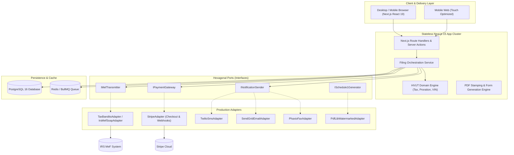
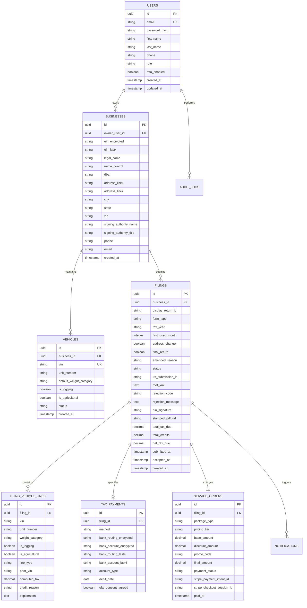

# Technical Requirement Specifications (TRS)
## IRS Form 2290 (HVUT) Commercial E-Filing Web Application

**Document Version:** 2.0 (Production Outsourcing Specification)  
**Target Project:** IRS Form 2290 Heavy Highway Vehicle Use Tax (HVUT) SaaS Platform  
**Target Audience:** Solution Architects, Lead Software Engineers, DevOps Engineers, Security Officers, QA Automation Leads  
**Classification:** Confidential / Technical Implementation Blueprint  

---

## Table of Contents
1. [Executive Architectural Summary](#1-executive-architectural-summary)
2. [Technology Stack & Runtime Standards](#2-technology-stack--runtime-standards)
3. [System Architecture & Hexagonal Ports-and-Adapters](#3-system-architecture--hexagonal-ports-and-adapters)
4. [Database Schema & Data Dictionary](#4-database-schema--data-dictionary)
5. [External Integration Specifications](#5-external-integration-specifications)
   - [5.1 IRS E-File MeF Gateway (TaxBandits API & Direct MeF)](#51-irs-e-file-mef-gateway-taxbandits-api--direct-mef)
   - [5.2 Stripe Payment Gateway Integration](#52-stripe-payment-gateway-integration)
   - [5.3 Twilio SMS Alert Integration](#53-twilio-sms-alert-integration)
   - [5.4 SendGrid / AWS SES Email Dispatch](#54-sendgrid--aws-ses-email-dispatch)
   - [5.5 Phaxio / eFax Automated DMV Delivery](#55-phaxio--efax-automated-dmv-delivery)
6. [Internal RESTful API Specifications](#6-internal-restful-api-specifications)
7. [High-Fidelity PDF Generation & IRS Watermarking Engine](#7-high-fidelity-pdf-generation--irs-watermarking-engine)
8. [Security, Cryptography & IRS Compliance (Pub 1075)](#8-security-cryptography--irs-compliance-pub-1075)
9. [DevOps, CI/CD & Hosting Infrastructure](#9-devops-cicd--hosting-infrastructure)
10. [Vendor Milestones, Testing & Delivery SLAs](#10-vendor-milestones-testing--delivery-slas)

---

## 1. Executive Architectural Summary

This document specifies the technical design, protocols, database schemas, API contracts, security controls, and infrastructure topology for the **IRS Form 2290 (HVUT)** SaaS e-filing platform.

### Architectural Principles
1. **Hexagonal Architecture (Ports & Adapters):** Strict boundary between domain tax logic and external gateways (IRS MeF, Stripe, Twilio, SendGrid), ensuring third-party providers can be updated or swapped without touching business rules.
2. **Stateless App Tier:** The Next.js application layer remains completely stateless, with state persisted in relational storage and cached via Redis to allow seamless horizontal autoscaling.
3. **Two-Stream Decoupled Financial Flows:** Platform revenue checkout (Stripe) is strictly decoupled from IRS tax liabilities (Federal ACH/EFW, EFTPS, IRS Card portal, Check voucher).
4. **Resilient Asynchronous Messaging:** Network-dependent IRS MeF transmissions and webhook callbacks are handled through resilient queues with exponential backoff and idempotency guards.

---

## 2. Technology Stack & Runtime Standards

| Tier | Component | Production Standard / Library | Minimum Version |
| :--- | :--- | :--- | :--- |
| **Frontend & SSR** | Next.js App Router | Next.js (Node runtime) | `v15.3+` |
| **UI Components** | React Engine | React / React DOM | `v19.0+` |
| **Language** | Static Typing | TypeScript (Strict Mode) | `v5.8+` |
| **Styling** | Utility CSS | Tailwind CSS (PostCSS engine) | `v4.1+` |
| **Icons** | SVG Icon System | `lucide-react` | `^0.511.0` |
| **Backend Runtime** | Server Environment | Node.js (Active LTS) | `Node 22.x LTS` |
| **Database** | Relational RDBMS | PostgreSQL (or AWS Aurora Serverless v2) | `PostgreSQL 16+` |
| **ORM / Query Engine**| Database Client | Drizzle ORM or Prisma Client | Latest |
| **Caching & Queues**| Async Jobs & Cache | Redis (Upstash or AWS ElastiCache) + BullMQ | `Redis 7.2+` |
| **PDF Generation** | Vector Overlay Engine | `pdf-lib` + fontkit | `^1.17.1` |
| **CSV Parser** | Fleet Upload Engine | `papaparse` | `^5.5.3` |
| **Validation** | Request Schema Validation| `zod` | `^3.25.0` |
| **E-File Gateway** | IRS Transmission | TaxBandits REST API (or IRS MeF SOAP/MTOM) | API v1.7.3 |
| **Payment Gateway**| Service Fee Checkout | Stripe SDK (`stripe`) | Latest API |
| **Process Manager**| VPS Hosting | PM2 (Cluster Mode) | `v5.4+` |
| **Reverse Proxy** | Web Server / SSL | Nginx + Certbot (Let's Encrypt TLS 1.3) | Stable |

---

## 3. System Architecture & Hexagonal Ports-and-Adapters



---

## 4. Database Schema & Data Dictionary

The production database must implement the following normalized relational schema with foreign key constraints, indexes, and field-level encryption:

### 4.1 Entity Relationship Diagram (ERD)



---

## 5. External Integration Specifications

### 5.1 IRS E-File MeF Gateway (TaxBandits API)

TaxBandits serves as the primary wholesale authorized IRS transmitter:

#### Environment Endpoints
- **Sandbox Auth:** `https://testoauth.expressauth.net/v2/tbs/auth`
- **Sandbox API Base:** `https://testapi.taxbandits.com/v1.7.3`
- **Production Auth:** `https://oauth.expressauth.net/v2/tbs/auth`
- **Production API Base:** `https://api.taxbandits.com/v1.7.3`

#### 1. OAuth Authentication
```http
POST /v2/tbs/auth HTTP/1.1
Host: testoauth.expressauth.net
Authentication: Bearer <USER_TOKEN>
Content-Type: application/json

{
  "client_id": "YOUR_CLIENT_ID",
  "client_secret": "YOUR_CLIENT_SECRET",
  "grant_type": "client_credentials"
}
```
**Response:**
```json
{
  "access_token": "eyJhbGciOiJSUzI1NiIs...",
  "token_type": "Bearer",
  "expires_in": 3600
}
```

#### 2. Create Form 2290 (`POST /Form2290/Create`)
```json
{
  "ReturnHeader": {
    "TaxYear": "2026-2027",
    "FirstUsedMonth": "07",
    "IsAddressChange": false,
    "IsFinalReturn": false,
    "IsConsentToDisclosure": true
  },
  "Business": {
    "BusinessNm": "ALPHA TRANSPORT LLC",
    "EIN": "123456789",
    "IsEIN": true,
    "Address1": "100 Industrial Pkwy",
    "City": "Dallas",
    "State": "TX",
    "ZipCd": "75201",
    "Phone": "2145550199",
    "Email": "dispatch@alphatransport.com"
  },
  "Form2290": {
    "TaxableVehicles": [
      {
        "VIN": "1FUJGLD50PL123456",
        "Category": "V",
        "IsLogging": false,
        "IsAgricultural": false,
        "TaxAmount": 550.00
      }
    ],
    "SuspendedVehicles": [],
    "CreditVehicles": [],
    "TotalTaxDue": 550.00,
    "TotalCredits": 0.00,
    "NetTaxDue": 550.00,
    "PaymentMethod": "EFW",
    "PaymentDetails": {
      "RoutingNumber": "122000496",
      "AccountNumber": "9876543210",
      "AccountType": "CHECKING",
      "PaymentAmount": 550.00
    }
  },
  "Signature": {
    "PIN": "54321",
    "SignerName": "John Doe",
    "SignerTitle": "Managing Member"
  }
}
```

#### 3. Transmit Form 2290 (`POST /Form2290/Transmit`)
```json
{
  "SubmissionId": "TB-SUB-2026-98124"
}
```

#### 4. Webhook Receiver (`POST /api/webhooks/taxbandits`)
The platform must expose an idempotent webhook receiver endpoint:
```json
{
  "SubmissionId": "TB-SUB-2026-98124",
  "Status": "Accepted",
  "Schedule1PdfUrl": "https://cdn.taxbandits.com/stamped/s1-98124.pdf",
  "AcceptedDate": "2026-08-15T14:22:10Z"
}
```
**Webhook Actions:**
1. Locate filing where `irs_submission_id = payload.SubmissionId`.
2. Transition filing status to `ACCEPTED`.
3. Set `accepted_at` and store `stamped_pdf_url`.
4. Enqueue automated email and SMS delivery with Schedule 1 attached.

---

### 5.2 Stripe Payment Gateway Integration

#### Hosted Checkout Session (`POST /api/checkout/stripe-session`)
- Initiated on Step 6 when user clicks "Pay with Stripe".
- Server creates Stripe Checkout session with metadata:
  ```typescript
  const session = await stripe.checkout.sessions.create({
    mode: 'payment',
    customer_email: business.email,
    line_items: [{
      price_data: {
        currency: 'usd',
        product_data: {
          name: `IRS Form 2290 Filing Fee (${quote.pricingTier})`,
        },
        unit_amount: Math.round(quote.finalAmount * 100),
      },
      quantity: 1,
    }],
    success_url: `${APP_URL}/file/new?editFilingId=${filing.id}&step=7&stripe_session_id={CHECKOUT_SESSION_ID}`,
    cancel_url: `${APP_URL}/file/new?editFilingId=${filing.id}&step=6`,
    metadata: { filingId: filing.id },
  });
  ```

#### Webhook Endpoint (`POST /api/webhooks/stripe`)
- Verifies cryptographic signature using `STRIPE_WEBHOOK_SECRET` and `stripe.webhooks.constructEvent(rawBody, sig, secret)`.
- On `checkout.session.completed`, marks filing `status = "PAID"` and stores Stripe Payment Intent ID.

---

### 5.3 Twilio SMS Alert Integration
- **Endpoint:** `POST https://api.twilio.com/2010-04-01/Accounts/{AccountSid}/Messages.json`
- **Trigger:** Immediate upon IRS status transition to `ACCEPTED` or `REJECTED`.
- **Payload:** Message body with short link to download the Schedule 1 PDF.

### 5.4 SendGrid / AWS SES Email Dispatch
- **Trigger:** Submission, Acceptance, Rejection.
- **Attachment:** For `ACCEPTED` returns, streams the PDF buffer directly as an email attachment:
  - Filename: `IRS_Form_2290_Schedule_1_{EIN}_{TAX_YEAR}.pdf`
  - MIME: `application/pdf`

### 5.5 Phaxio / eFax Automated DMV Delivery
- **Trigger:** User selected `addOnFax = true` at checkout.
- **Action:** POST to Phaxio API `/v2.1/faxes` sending the Schedule 1 PDF file to the destination fax number with automated transmission confirmation receipt logging.

---

## 6. Internal RESTful API Specifications

| Method | Endpoint | Description | Auth Required |
| :--- | :--- | :--- | :--- |
| `POST` | `/api/auth/register` | Register new user account | No |
| `POST` | `/api/auth/login` | Authenticate user & issue session token | No |
| `GET` | `/api/bootstrap` | Fetch current session, businesses, and vehicles | Yes |
| `GET/POST`| `/api/businesses` | List / Create business entities | Yes |
| `POST` | `/api/businesses/:id/carry-forward` | Carry forward fleet vehicles to new tax year | Yes |
| `GET/POST`| `/api/filings` | List / Create filing returns | Yes |
| `GET/PUT` | `/api/filings/:id` | Retrieve / Update filing draft | Yes |
| `POST` | `/api/filings/:id/checkout-submit`| Pay platform service fee & transmit to IRS | Yes |
| `POST` | `/api/filings/:id/sync-status` | On-demand live IRS status sync from transmitter | Yes |
| `GET` | `/api/filings/:id/schedule1` | Stream official IRS-stamped Schedule 1 PDF | Yes |
| `GET` | `/api/filings/:id/form2290` | Stream populated Form 2290 Return PDF | Yes |
| `GET` | `/api/filings/:id/voucher` | Stream Form 2290-V Payment Voucher PDF | Yes |
| `POST` | `/api/checkout/stripe-session`| Create hosted Stripe Checkout URL | Yes |
| `POST` | `/api/webhooks/stripe` | Stripe payment confirmation webhook | Signature |
| `POST` | `/api/webhooks/taxbandits`| IRS MeF status update callback webhook | IP / Secret |

---

## 7. High-Fidelity PDF Generation & IRS Watermarking Engine

The platform must maintain pixel-perfect overlays onto official IRS standard PDF templates (`REFERANCE DOCUMENTS/f2290_FORMAT.pdf`) using `pdf-lib`:

### Form 2290 Page Map
- **Page 1 & 2:** Form 2290 Return Pages (EIN comb characters, legal name, address, tax computations).
- **Page 3 & 4:** Schedule 1 (Copy A) - Form 2290 (Taxable vehicles VIN table, suspended category, watermarks).
- **Page 5:** Schedule 1 (Copy B) - Duplicate for DMV registration.
- **Page 6:** Form 2290-V Payment Voucher (Tax amount, EIN comb cells, IRS mailing address).

### Watermark Placement Matrix
```typescript
// Official IRS Stamped Schedule 1 Digital Watermark Stamp Coordinates
const WATERMARK_CONFIG = {
  text: `IRS e-file - RECEIVED\n${formattedTimestamp}\nINTERNAL REVENUE SERVICE`,
  x: 410,
  y: 690,
  rotationDegrees: 0,
  fontSize: 8.5,
  fontColor: rgb(0.06, 0.14, 0.52), // Official IRS Navy Ink
  boxBorder: { x: 400, y: 675, width: 190, height: 45, borderWidth: 1.5 }
};
```

---

## 8. Security, Cryptography & IRS Compliance (Pub 1075)

1. **Field-Level Data Encryption (At Rest):**
   - Taxpayer EINs, Bank Routing Numbers, and Bank Account Numbers must be encrypted at the database application layer using **AES-256-GCM** with an envelope key rotation scheme.
   - Plaintext bank credentials must never be output to application log files.
2. **Data in Transit:**
   - Strict HTTPS TLS 1.3 encryption across all public and internal service boundaries.
   - HSTS (`Strict-Transport-Security`) headers enabled.
3. **Multi-Tenant Data Isolation:**
   - All database queries must enforce tenant isolation (`WHERE business_id = :id AND owner_user_id = :userId`) to prevent cross-account data leakage.
4. **Audit Logging:**
   - Immutable write-only audit logs recording every taxpayer submission, modification, administrative access, and payment attempt.

---

## 9. DevOps, CI/CD & Hosting Infrastructure

### Recommended Hosting Topology
- **Hostinger KVM VPS** (or AWS ECS / EKS with RDS PostgreSQL).
- **Process Management:** PM2 running Next.js server on cluster mode (`ecosystem.config.cjs`).
- **Nginx Reverse Proxy:** Port 80/443 SSL termination forwarding to localhost:3000.

### PM2 Configuration (`ecosystem.config.cjs`)
```javascript
module.exports = {
  apps: [
    {
      name: 'irs-hvut',
      script: 'node_modules/next/dist/bin/next',
      args: 'start',
      instances: 'max',
      exec_mode: 'cluster',
      autorestart: true,
      max_memory_restart: '1G',
      env: {
        NODE_ENV: 'production',
        PORT: 3000,
      },
    },
  ],
};
```

### GitHub Actions CI/CD (`.github/workflows/deploy.yml`)
- Automates: Linting &rarr; TypeScript Typecheck &rarr; Production Build &rarr; SSH Deployment to Hostinger VPS &rarr; Zero-downtime PM2 reload.

---

## 10. Vendor Milestones, Testing & Delivery SLAs

The vendor will be evaluated against the following milestones:

| Milestone | Deliverables | Acceptance Criteria |
| :---: | :--- | :--- |
| **M1** | Database Migration & Auth RBAC | Multi-user onboarding, multi-EIN switcher, PostgreSQL schema. |
| **M2** | HVUT Domain Engine & 8-Step Wizard | Accurate prorated tax engine, 17-char VIN check-digit validator, CSV fleet bulk upload. |
| **M3** | Two-Stream Payments (Stripe & EFW) | Stripe Checkout session integration + EFW 9-digit ABA routing checksum validation. |
| **M4** | IRS MeF Transmission & Webhooks | TaxBandits / MeF adapter, automated webhook receiver, real-time Schedule 1 generation. |
| **M5** | PDF Generation & Form 2290-V | Pixel-perfect `pdf-lib` overlay onto official IRS Form 2290 and watermarked Schedule 1. |
| **M6** | End-to-End ATS & Pen-Testing | 100% pass on automated tax calculation test suites, OWASP Top 10 security audit, load test to 1,000 concurrent filers. |
