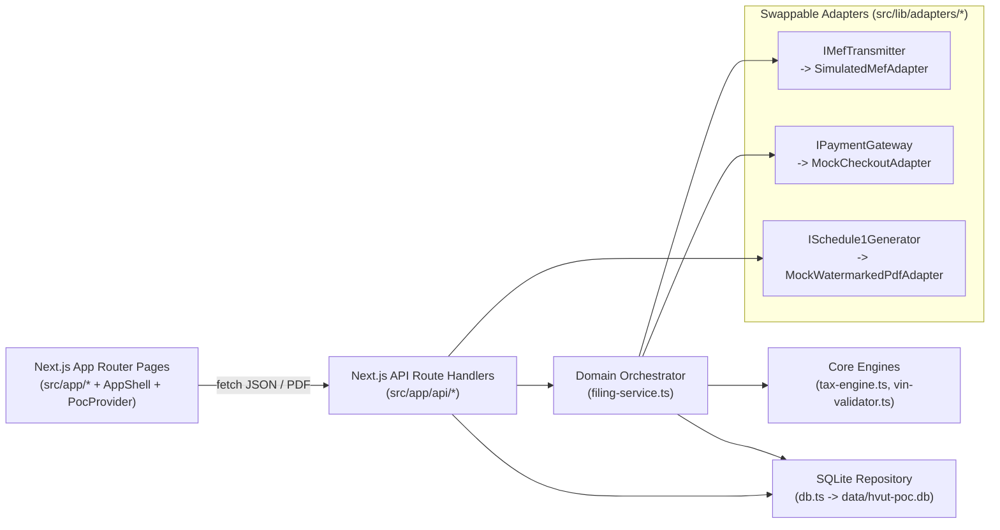
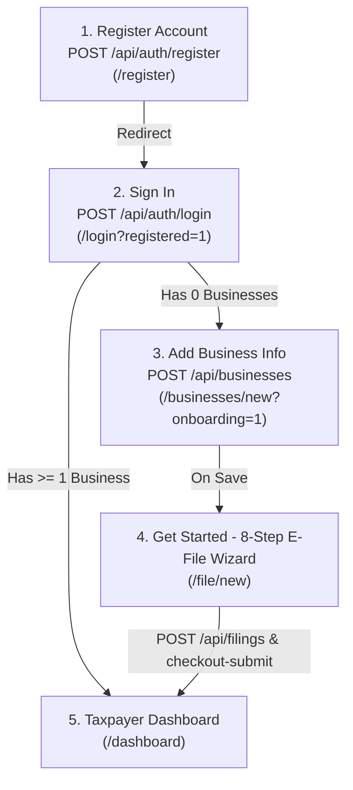
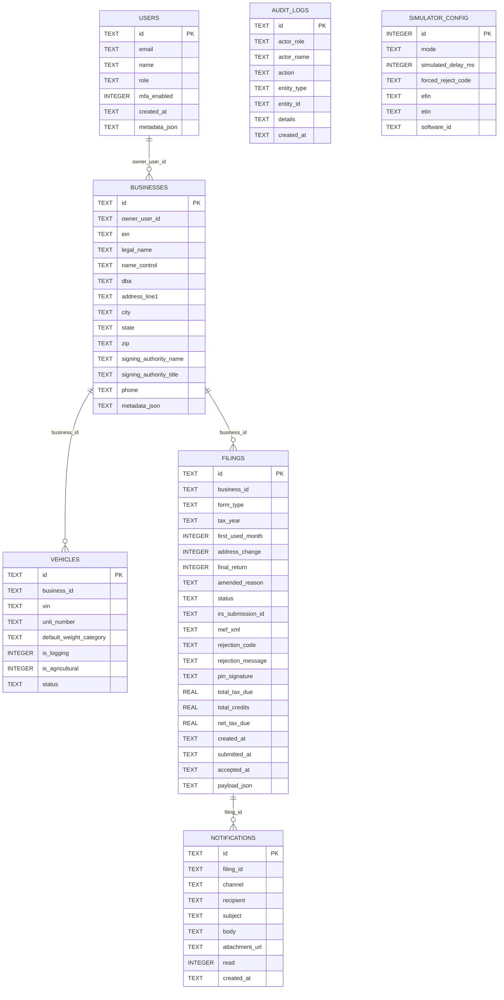

# IRS-HVUT (2290 Tax Filings) — Technical Specification Document

**Version:** 1.1  
**Tax Period Support:** IRS Form 2290 (Rev. July 2026) & Form 8849 Schedule 6  
**Last Updated:** 2026-11-14  
**Repository:** `irs-hvut-2290-poc` (`v0.1.0`)

---

## 1. Executive Summary & System Scope

**IRS-HVUT (`2290 tax filings`)** is a full-stack web application for preparing, validating, computing, paying service fees on, and electronically transmitting IRS **Form 2290 (Heavy Highway Vehicle Use Tax Return)** and **Form 8849 Schedule 6 (Claims)**, with programmatic generation of IRS Form 2290, e-file watermarked **Schedule 1 (Copy A & Copy B)**, and **Form 2290-V Payment Vouchers**.

### Core Capabilities
- **Multi-Form Support:**
  - Original Form 2290 (`2290_ORIG`): Taxable vehicles (Categories A–V), Logging (25% reduced tax), Agricultural/Suspended (`Category W`, $\le 5{,}000$ mi standard / $\le 7{,}500$ mi agricultural), and inline Prior-Year Suspended & Credit vehicle lines (`CREDIT`, `CREDIT_LOW_MILEAGE`, `CREDIT_OVERPAID`).
  - Form 2290 Amendments (`2290_AMEND`): Taxable Gross Weight increase (`WEIGHT_INCREASE`) with differential prorated tax calculation, and Suspended Vehicle Exceeding Mileage Limit (`MILEAGE_EXCEEDED`).
  - Free Native VIN Correction (`2290_VIN_CORR`): Corrects erroneous 17-character VINs against accepted filings at a \$0.00 service fee (`isNativeVinCorrection = true`).
  - Form 8849 Schedule 6 (`8849_SCH6`): Refund claims for sold/destroyed/stolen vehicles, low-mileage credits ($\le 5{,}000$ / $\le 7{,}500$ mi), and overpaid HVUT tax.
- **Standalone 2290 Tax Calculator:** Publicly accessible on `/tax-calculator` for calculating prorated Category A–W taxes (standard vs. logging) and statutory IRS deadlines before signing in.
- **Guided 8-Step E-File Wizard (`/file/new`):** Stateful return preparation, CSV bulk upload (via `papaparse`), duplicate/check-digit VIN validation, IRS e-file payment routing, tiered checkout, PDF summary preview, and e-file transmission.
- **Zero-Preseeded Multi-User Onboarding:** Clean SQLite database (`purgeSeededDummyData`) requiring explicit registration (`/register`), sign-in (`/login`), first-time business entity creation (`/businesses/new?onboarding=1`), first filing setup (`/file/new`), and return management (`/dashboard`).
- **Hexagonal Ports & Adapters Simulator:** Clean interface boundary isolating tax/business logic from IRS MeF XML transmission, Stripe-like payment processing, PDF generation, and delivery notifications so external providers can be swapped without modifying domain services.

---

## 2. Technology Stack & Runtime Dependencies

| Layer | Technology / Package | Version (`package.json`) | Purpose |
| :--- | :--- | :--- | :--- |
| **Framework** | Next.js (App Router) | `^15.3.2` | Server & client rendering (`"use client"` views + Route Handlers in `src/app/api/*`) |
| **UI Runtime** | React / React DOM | `^19.1.0` | Component tree & reactive client state |
| **Language** | TypeScript | `^5.8.3` | Strict static typing across domain models, adapters, APIs, and pages |
| **Styling** | Tailwind CSS + `@tailwindcss/postcss` | `^4.1.7` | Utility styling; Federal Indigo-Blue, Slate-Navy, & Warm Amber design system |
| **Icons** | `lucide-react` | `^0.511.0` | Navigation, status badges, wizard steps, modal actions |
| **Database** | Node built-in `node:sqlite` (`DatabaseSync`) | Node 22 Built-in | Embedded WAL-mode SQLite persistence at `data/hvut-poc.db` |
| **PDF Engine** | `pdf-lib` | `^1.17.1` | Overlay population onto official `REFERANCE DOCUMENTS/f2290_FORMAT.pdf` |
| **CSV Parser** | `papaparse` | `^5.5.3` | Bulk fleet VIN & weight category CSV upload & template export |
| **Validation** | `zod` | `^3.25.32` | Request payload validation in auth & business API routes |
| **Testing / Types** | `@types/node` `^22.15.18`, `@types/react` `^19.1.4`, `@types/papaparse` `^5.3.16` | DevDependencies | Static typechecking (`npm run typecheck` / `tsc --noEmit`) |

---

## 3. System Architecture & Ports-and-Adapters Design

The backend separates core HVUT domain rules (`src/lib/hvut/*`) from external system gateways via TypeScript port interfaces (`src/lib/adapters/types.ts`).

### Port Interfaces (`src/lib/adapters/types.ts`)

| Interface | Concrete Implementation | Responsibility |
| :--- | :--- | :--- |
| `IMefTransmitter` | `SimulatedMefAdapter` (`src/lib/adapters/mef-simulator.ts`) | Builds IRS MeF `<Return>` XML (`buildSimulatedMefXml`), validates EIN, Name Control, duplicate/invalid VINs, and simulates `ACCEPTED`, `EDITING_AFTER_REJECT`, `TRANSMITTED_TO_IRS`, or `QUEUED` (`GATEWAY-503`). |
| `IPaymentGateway` | `MockCheckoutAdapter` (`src/lib/adapters/payment-simulator.ts`) | Computes Stream A platform service fee quotes (`computeServiceFeeQuote`), promo discounts, fax/SMS add-ons, and authorizes/declines card charges. |
| `ISchedule1Generator` | `MockWatermarkedPdfAdapter` (`src/lib/adapters/pdf-generator.ts`) | Generates multi-page Form 2290 PDFs (`generateForm2290Pdf`), Schedule 1 with optional `IRS e-file` watermark (`generateSchedule1Pdf`), and Form 2290-V vouchers (`generate2290VPdf`). |
| `INotificationSender` | `addNotification` in `src/lib/hvut/db.ts` via `dispatchOutcomeNotifications` | Records EMAIL, SMS, and FAX outcome notifications in SQLite and surfaces them in the UI Inbox drawer. |

---

## 4. Authentication, Multi-Tenant Isolation & Onboarding Workflow

### Route Access Matrix (`src/components/AppShell.tsx`)

- **`PUBLIC_ROUTES`:** `"/"`, `"/login"`, `"/register"`, `"/tax-calculator"`
  - Unauthenticated navigation bar (`PUBLIC_NAV`) exposes `Home` (`/`) and `Tax Calculator` (`/tax-calculator`), plus `Sign In` (`/login`) and `Register Free` (`/register`) actions.
  - All filing workflow cards on `/` (`Form 2290 Tax Return`, `Form 2290 Amendment`, `Free VIN Correction`) resolve via `resolveProtectedHref(...)` to `/login` when signed out; only the `2290 Tax Calculator` card opens `/tax-calculator` directly.
- **Protected Routes (`/dashboard`, `/businesses/new`, `/file/new`, `/post-filing`, `/user-guide`, `/admin`):**
  - When `!loading && !isAuthenticated && !isPublicRoute`, `AppShell` redirects via `router.replace("/login")` and renders a `Sign In Required` gate instead of application data.
  - Authenticated navigation (`AUTH_NAV`) exposes `Home` (`/dashboard`), `File a Return` (`/file/new`), and `Tax Calculator` (`/tax-calculator`).

### Session & Multi-User Isolation (`src/components/PocProvider.tsx`)

1. Client session persistence uses `localStorage` key `irs_hvut_active_user` (`STORAGE_KEY`). Logging out sets `STORAGE_KEY = "logged_out"`.
2. On mount and `refresh()`, `PocProvider` fetches `GET /api/bootstrap` and validates that the stored user ID exists in `users`; otherwise, `isAuthenticated` remains `false`.
3. `DashboardPage` (`src/app/dashboard/page.tsx`) filters `businesses` by `b.ownerUserId === activeUser.id` for `OWNER_OP` and `FLEET` users (`CPA` and `ADMIN` can inspect all businesses), and restricts `bizFilings` and `bizVehicles` to the selected `activeBusinessId`.
4. Note: `/api/bootstrap` currently returns full collections to `PocProvider` in this local PoC. Production hardening requires server-side HTTP-only session cookies and SQL `WHERE owner_user_id = ?` scoping inside API handlers.

### First-Time User Onboarding Sequence

- When `/dashboard` detects `!loading && activeUser && activeUser.role !== "ADMIN" && visibleBusinesses.length === 0`, it automatically redirects to `/businesses/new?onboarding=1`.
- Submitting `/businesses/new` without an `editId` routes directly to `/file/new` (Step 1: Get Started). Editing an existing business routes back to `/dashboard`.

---

## 5. Database Schema & Persistence Layer (`src/lib/hvut/db.ts`)

Data is stored locally in `data/hvut-poc.db` using `node:sqlite` (`DatabaseSync`) with `PRAGMA journal_mode = WAL`. Startup calls `seedIfEmpty(db)` (initializing `simulator_config` row `id = 1` with `mode = "AUTO_ACCEPT"`, `simulated_delay_ms = 500`, `forced_reject_code = "F2290-001"`, `efin = "990001"`, `etin = "SIM01"`, `software_id = "TD2290-V11"`) followed by `purgeSeededDummyData(db)` to guarantee zero pre-populated dummy users, businesses, vehicles, filings, or notifications.

### Key Serialization & Identifiers
- **`users.metadata_json`:** Stores `firstName`, `lastName`, `phone`, `password`. (Plaintext in PoC; must use Argon2id/bcrypt in production).
- **`businesses.metadata_json`:** Stores `businessType`, `country`, `roomSuite`, `otherCity`, `cellNumber`, `pocName`, `pocEmail`, `pocPhone`, `signingAuthorityEmail`, `thirdPartyDesignee`.
- **`filings.payload_json`:** Stores `displayReturnId`, `eFileMethod`, `thirdPartyAssigned`, `consentToDisclosure`, `priorYearSuspendedAllUnderLimit`, `packageType`, `additionalEmails`, `lines: FilingVehicleLine[]`, `serviceOrder: ServiceOrder`, `taxPayment: TaxPaymentInstruction`.
- **`makeDisplayReturnId(formType, taxYear)`:** Generates human-readable return IDs: `F{yy}-{MMDD}-{RAND4}` (Original 2290), `A{yy}-...` (Amendment), `V{yy}-...` (VIN Correction), `C{yy}-...` (Form 8849 Schedule 6).

---

## 6. Core Domain Engines & Mathematical Specifications

### 6.1 HVUT Tax Calculation Engine (`src/lib/hvut/tax-engine.ts`)

1. **Weight Category Schedule (IRS Form 2290 Part I & Part II):**
   - **Category `A` (55,000 lbs):** Annual standard = \$100.00; Logging = \$75.00.
   - **Categories `B`–`U` (55,001 lbs – 75,000 lbs):** Each 1,000-lb bracket index $i \in [1, 20]$ spans $55{,}000 + (i - 1)\cdot 1{,}000 + 1$ to $55{,}000 + i \cdot 1{,}000$ lbs.
     $$\text{AnnualStandard}(i) = 100 + 22 \cdot i, \qquad \text{AnnualLogging}(i) = \text{round}_2\left(0.75 \cdot \text{AnnualStandard}(i)\right)$$
   - **Category `V` (Over 75,000 lbs):** Annual standard = \$550.00; Logging = \$412.50.
   - **Category `W` (Suspended $\le 5{,}000$ mi standard / $\le 7{,}500$ mi agricultural):** \$0.00.

2. **Partial-Year Proration (`calculateVehicleTax`):**
   IRS tax year runs July 1 through June 30 (`TAX_PERIOD_MONTHS`: July = 12 remaining months down to June = 1 remaining month):
   $$\text{Tax}(\text{cat}, \text{isLogging}, m) = \text{round}_2\!\left(\frac{\text{AnnualRate}(\text{cat}, \text{isLogging}) \times \text{RemainingMonths}(m)}{12}\right)$$

3. **Weight Increase Amendment (`calculateWeightIncreaseTax`):**
   $$\Delta\text{Tax} = \max\!\left(0,\ \text{round}_2\!\left(\text{calculateVehicleTax}(\text{newCat}, \text{isLogging}, m) - \text{calculateVehicleTax}(\text{priorCat}, \text{isLogging}, m)\right)\right)$$

4. **Statutory Filing Deadline (`getFilingDeadline`):**
   - For July (`firstUsedMonth === 7`) in tax year starting `startYear`, due date is **`August 31, {startYear}`**.
   - For any other first-use month ($8$–$12$ in `startYear`, $1$–$6$ in `startYear + 1`), due date is the **last calendar day of the month following first use** (`new Date(dueYear, dueMonth, 0).getDate()`).

5. **IRS Business Name Control (`deriveNameControl`):**
   Uppercases `legalName`, strips word-boundary tokens `LLC`, `INC`, `CORP`, `CO`, `LTD`, `LP`, `LLP`, removes non-alphanumeric characters, takes the first 4 characters, and right-pads with `"X"` if fewer than 4 characters remain.

### 6.2 VIN & EIN Validation Engine (`src/lib/hvut/vin-validator.ts`)

1. **VIN Rules (`validateVin(rawVin, allowPre1981Override = false)`):**
   - Normalizes via `trim().toUpperCase()`.
   - Requires exact length `17`, alphanumeric `[A-Z0-9]` only, and prohibits letters `I`, `O`, and `Q`.
   - Computes ISO 3779 check digit at index `8` (position 9) using standard VIN letter transliteration map (`A..Z -> 1..9`) and positional weights `[8, 7, 6, 5, 4, 3, 2, 10, 0, 9, 8, 7, 6, 5, 4, 3, 2]`:
     $$\text{CheckDigit} = \begin{cases} \text{"X"} & \text{if } \left(\sum_{k=0}^{16} \text{val}(v_k)\cdot w_k\right) \bmod 11 = 10 \\ \text{String}(r) & \text{otherwise} \end{cases}$$
   - When `allowPre1981Override` is `true` (used during wizard transmission for legacy heavy trucks), a check-digit mismatch emits `checkDigitWarning` rather than blocking transmission.
   - `generateValidTestVin(seedNumber?)` generates realistic Class-8 Freightliner/Kenworth/Peterbilt ISO-valid VINs (`1FU`, `1XK`, `1XP`, `3AK`, `2HS`).

2. **EIN Rules (`validateEin(rawEin)`):**
   - Strips non-digits and requires exactly `9` digits.
   - Rejects all-identical digits (`^(\d)\1{8}$`) and prefixes `"00"` or `"66"` (to block SSNs / invalid prefixes).
   - Formats canonically as `XX-XXXXXXX`.

### 6.3 Service Fee Pricing Engine (`src/lib/adapters/payment-simulator.ts`)

Stream A (IRS-HVUT platform fee) is separate from Stream B (IRS tax liability).

| Filing / Plan | Vehicle Count | Base Service Fee |
| :--- | :--- | :--- |
| Original Return (`PER_VEHICLE`) | `1` | \$7.99 |
| Original Return (`PER_VEHICLE`) | `2` | \$14.99 |
| Original Return (`PER_VEHICLE`) | `3`–`5` | \$19.99 |
| Original Return (`PER_VEHICLE`) | `6`–`25` | \$49.99 |
| Original Return (`PER_VEHICLE`) | `26`–`100` | \$99.99 |
| Unlimited Single Return (`UNLIMITED_SINGLE`) or `> 100` | Any | \$139.99 |
| Unlimited Annual (`UNLIMITED_ANNUAL`) | Unlimited filings for period | \$199.99 |
| Form 2290 Amendment (`2290_AMEND`) | Any | \$19.99 |
| Form 8849 Schedule 6 (`8849_SCH6`) | Any | \$19.99 |
| Native VIN Correction (`2290_VIN_CORR`, `isNativeVinCorrection = true`) | Any | \$0.00 |
| External VIN Correction (`isNativeVinCorrection = false`) | Any | \$9.99 |
| Rejected Return Resubmission (`isResubmissionAfterReject = true`) | Any | \$0.00 (`WAIVED_RESUBMIT`) |

- **Optional Add-Ons:** Fax Copy (\$1.00 if `addOnFax`), SMS Text Alert (\$1.00 if `addOnSms`).
- **Promo Codes:** `TRUCK10` (10% off `baseAmount`), `FLEET25` (\$25.00 flat off up to `baseAmount`), `POCFREE` (100% off `baseAmount`).
- **Simulated Card Processing:** Cards beginning with `4000` return HTTP `402` with `paymentStatus = "DECLINED"`; any other card (e.g. `4242424242424242`) approves.
- **Deferred Submission (`skipTransmit`):** Allows Step 6 Checkout to record `status = "PAID"` and `serviceOrder.paymentStatus = "PAID"` before Step 7/8 PIN entry & MeF submission.

### 6.4 IRS MeF XML & Rejection Rules (`src/lib/adapters/mef-simulator.ts` & `rejection-codes.ts`)

`buildSimulatedMefXml` constructs UTF-8 XML matching `<Return xmlns="http://www.irs.gov/efile" returnVersion="{startYear}v1.0-SIM">` containing `ReturnHeader` (`TaxPeriodBeginDt`, `TaxPeriodEndDt`, `SoftwareId`, `EFIN`, `ETIN`, `SubmissionId`, `Filer`, `TaxpayerPIN`) and `ReturnData` (`<IRS2290>` or `<IRS8849Schedule6>` with `<Schedule1Vehicles>`).

**Validation & Outcome Pipeline in `SimulatedMefAdapter.transmit`:**
1. If `mode === "GATEWAY_OUTAGE"`, returns `status = "QUEUED"` (`GATEWAY-503`).
2. Runs EIN validation (`R0000-905` on failure).
3. Runs Name Control check (`F2290-001` if `nameControl === "BAD1"`, `einDigits.endsWith("99")`, or `nameControl !== deriveNameControl(legalName)`).
4. Checks `einDigits.endsWith("88")` for deterministic `R0000-905` testing.
5. Iterates vehicle lines:
   - Invalid VIN format -> `F2290-011`.
   - Duplicate VIN inside same return -> `F2290-023`.
   - VIN already accepted on prior `2290_ORIG` return in same tax year (`existingAcceptedVins`) -> `F2290-023`.
6. Applies simulator mode outcome: `AUTO_REJECT` -> `EDITING_AFTER_REJECT` (`forcedRejectCode`), `MANUAL_REVIEW` -> `TRANSMITTED_TO_IRS`, `AUTO_ACCEPT` -> `ACCEPTED`.

### 6.5 PDF Generation Engine (`src/lib/adapters/pdf-generator.ts`)

Reads the official IRS template PDF at `REFERANCE DOCUMENTS/f2290_FORMAT.pdf` via `pdf-lib` using Helvetica / HelveticaBold in `NAVY_INK = rgb(0.06, 0.14, 0.52)`:

| Method | Template Pages Copied (`0`-indexed) | Behavior |
| :--- | :--- | :--- |
| `generateSchedule1Pdf` | Page index `4` (Schedule 1, paginated up to 24 vehicles/page) | Draws Legal Name, combed 9-box EIN, address, `YYYYMM` first-use, Part I totals `(a, b, c)`, Part II VINs/categories, and stamps vertical `"IRS e-file"` ellipse + diagonal `"Received MM/DD/YYYY"` watermark when `filing.status === "ACCEPTED"` (or `"DRAFT PREVIEW - NOT YET TRANSMITTED TO IRS"` otherwise). |
| `generateForm2290Pdf` | Pages `[2, 3]` (Form 2290), `[4]` (Schedule 1, paginated), `[8]` (Consent to Disclosure), `[9]` (Form 2290-V) | Combines complete Form 2290 packet with checkboxes, Category A–W breakdowns, credits, PIN signature / consent, Schedule 1, and 2290-V payment voucher. |
| `generate2290VPdf` | Page index `9` (Form 2290-V) | Populates standalone payment voucher for `CHECK` / money order taxpayers. |

---

## 7. REST API Specification (`src/app/api/*`)

| Endpoint | Method | Request Body / Query | Response / Status Codes |
| :--- | :--- | :--- | :--- |
| `/api/bootstrap` | `GET` | — | `200`: `{ users, businesses, vehicles, filings, notifications, auditLogs, simulatorConfig }` |
| `/api/auth/register` | `POST` | `{ firstName, lastName, email, phone, password }` (Zod validated) | `200`: `{ user }`; `400`: validation error; `409`: duplicate email; creates `OWNER_OP` user + audit log |
| `/api/auth/login` | `POST` | `{ email, password }` | `200`: `{ user }` (without `password`); `400`/`401`: invalid credentials |
| `/api/businesses` | `POST` | `BusinessSchema` payload (`id?`, `ownerUserId`, `ein`, `legalName`, `addressLine1`, `city`, `state`, `zip`, `signingAuthority*`, `phone`, optional `thirdPartyDesignee`) | `200`: `{ business }`; `400`: Zod or EIN error |
| `/api/businesses/[id]/carry-forward` | `POST` | `{ taxYear? }` (default `"2026-2027"`) | `200`: `{ filing }` (`DRAFT` cloning active fleet VINs); `404`: business missing |
| `/api/filings` | `GET` | `?businessId=...` | `200`: `{ filings }` |
| `/api/filings` | `POST` | Partial `ReturnFiling` (`businessId`, `formType`, `taxYear`, `lines`, etc.) | `200`: `{ filing }` (recomputes `totalTaxDue`, `totalCredits`, `netTaxDue`); `400`/`404` |
| `/api/filings/[id]/checkout-submit` | `POST` | `{ cardNumber, cardType?, promoCode?, packageType?, addOnFax?, addOnSms?, addOnEmail?, additionalEmails?, faxNumber?, pinSignature?, taxPayment, hasUnlimitedAnnualPlan?, skipTransmit? }` | `200`: `{ filing }`; `402`: payment declined; `500`: error |
| `/api/filings/[id]/simulate-decision` | `POST` | `{ decision: "ACCEPT" \| "REJECT", rejectionCode?, actorName? }` | `200`: `{ filing }`; triggers notifications & `ADMIN_SIMULATED_*` audit log |
| `/api/filings/[id]/form2290` | `GET` | — | `200` `application/pdf`: Full Form 2290 PDF packet (`inline`); `404` |
| `/api/filings/[id]/schedule1` | `GET` | — | `200` `application/pdf`: Watermarked Schedule 1 (`ACCEPTED` only); `400` if not accepted; `404` |
| `/api/filings/[id]/voucher` | `GET` | — | `200` `application/pdf`: Form 2290-V voucher; `404` |
| `/api/notifications/read` | `POST` | — | `200`: `{ ok: true }` (marks all notifications read) |
| `/api/simulator` | `GET` | — | `200`: `{ simulatorConfig }` |
| `/api/simulator` | `PATCH` | `{ action?: "RESET", mode?, simulatedDelayMs?, forcedRejectCode?, efin?, etin?, softwareId? }` | `200`: `{ simulatorConfig }` (or `{ reset: true, simulatorConfig }`) |

---

## 8. Frontend Routes, 8-Step E-File Wizard & UI Design System

### Route Catalog (`src/app/*`)

| Route | Auth Required | Purpose |
| :--- | :--- | :--- |
| `/` | Public | Landing page: Hero CTA (`Register Free Account`, `Sign In to File`), embedded Sign-In form, 4 workflow cards (Calculator public; 3 Form 2290/Amendment/VIN cards gated to `/login`). |
| `/login` | Public | Two-column IRS-HVUT sign-in page supporting `?registered=1` banner and smart post-login routing (`/businesses/new?onboarding=1` vs `/dashboard`). |
| `/register` | Public | Two-column registration page creating `OWNER_OP` account and redirecting to `/login?registered=1`. |
| `/tax-calculator` | Public | Interactive Category A–W + Logging HVUT tax & IRS deadline estimator; Sign-In-aware breadcrumb & CTA. |
| `/businesses/new` | Protected | Taxpayer Business Profile, Address, Point of Contact, Signing Authority, Third-Party Designee (`?editId=...` to update existing business). |
| `/file/new` | Protected | 8-Step Form 2290 / Amendment / VIN Correction / 8849 wizard + Add/Edit Vehicle, Prior-Year Sold/Suspended, Bulk CSV Upload, and MeF XML modals. |
| `/dashboard` | Protected | Active Business selector (Add Business / Edit Business / Carry-Forward Fleet), Return Summary table (`Return ID`, `Form Type`, `Status`, `Action`, `View PDF`, `Schedule1 PDF`, `XML`), and Saved Fleet Roster. |
| `/post-filing` | Protected | Direct Post-Filing Operations Console (VIN Correction, Weight/Mileage Amendments, Form 8849 Sch 6 Claims). |
| `/user-guide` | Public/Shell | Interactive step-by-step Form 2290 visual walkthrough carousel. |
| `/admin` | Protected | Internal IRS MeF Simulator Console (`AUTO_ACCEPT`, `MANUAL_REVIEW`, `AUTO_REJECT`, `GATEWAY_OUTAGE`), audit logs, manual queue review, DB reset (unlinked from public navigation). |

### 8-Step E-File Wizard (`src/app/file/new/page.tsx`)

| Step | Label | Key Operations |
| :--- | :--- | :--- |
| **1** | `Get Started` | Choose Business Entity, Filing Type (`2290_ORIG`, `2290_AMEND`, `2290_VIN_CORR`, `8849_SCH6`), Tax Year (`2026-2027` .. `2024-2025`), and Month of First Use. |
| **2** | `Tax Options` | Address Change, Final Return, Amended Reason (`WEIGHT_INCREASE` / `MILEAGE_EXCEEDED`), Prior-Year Suspended mileage declaration. |
| **3** | `Vehicle Info` | Tabbed entry across Taxable, Suspended (`W`), Credit (`CREDIT`, `CREDIT_LOW_MILEAGE`, `CREDIT_OVERPAID`), Prior-Year Suspended, and VIN Corrections; inline VIN validator, Bulk CSV import (`irs-hvut-bulk-sample.csv`), and instant tax computation. |
| **4** | `IRS Options` | E-File Method (`EFW`, `EFTPS`, `CARD`, `CHECK`), bank routing/account + debit date (EFW), Consent to Disclosure, Third-Party Designee toggle. |
| **5** | `Pricing` | Package selection (`PER_VEHICLE`, `UNLIMITED_SINGLE`, `UNLIMITED_ANNUAL`), promo code evaluation (`TRUCK10`, `FLEET25`, `POCFREE`), Fax (\$1.00) & SMS (\$1.00) add-ons. |
| **6** | `Checkout` | Platform Service Fee card checkout (`POST /api/filings/[id]/checkout-submit` with `skipTransmit: true` when proceeding to review, or immediate submit). |
| **7** | `Form Summary` | Read-only Form 2290 Tax Summary, vehicle count & net tax review, Form 2290 PDF preview link, and 5-digit Taxpayer PIN E-Signature confirmation. |
| **8** | `Submit Return` | Final IRS MeF transmission, live acceptance/rejection banner, Printable Payment Receipt, Stamped Schedule 1 download link, Form 2290-V download, and MeF XML inspector. |

### UI/UX & Brand Identity (`src/components/AppShell.tsx`)
- **Brand Wordmark:** `IRS-HVUT` with subtitle `2290 tax filings` and custom Indigo-Blue & Amber Highway Semi-Truck SVG badge (`IrsHvutLogo`).
- **Color Tokens:**
  - Primary Action / Accent: `#1e40af` (Indigo 800), hover `#1e3a8a` (Indigo 900)
  - Secondary / Info Highlight: `#0284c7` (Sky 600), hover `#0369a1`
  - Dark Header / Hero Slate-Navy: `#0f172a` (Slate 900) & `#1e293b` (Slate 800)
  - Warm Amber Accent: `#f59e0b` (Amber 500)
  - Surface / Border: `#f1f5f9` app background, `#ffffff` cards, `border-b-2 border-[#1e40af]` main header
- **Topmost Utility Header:** `IRS-HVUT Portal · 2290 tax filings` + `IRS MeF Rev. July 2026` badge (`Electronic Schedule 1 Gateway`).
- **Footer:** `IRS HVUT FORM 2290 E FILE SIMULATOR`.

---

## 9. Production Readiness & Cutover Checklist

To transition **IRS-HVUT v1.1** from local PoC simulation to live production IRS e-filing:

1. **IRS MeF Gateway:** Replace `SimulatedMefAdapter` with an IRS-certified A2A MTOM/SOAP client transmitting Schema-validated `IRS2290` XML using production EFIN, ETIN, Software ID, and X.509 mutual TLS certificates.
2. **Database & PII Security:** Migrate `node:sqlite` (`data/hvut-poc.db`) to PostgreSQL (e.g., Cloud SQL / Neon) with row-level tenant isolation, envelope encryption (`AES-256-GCM`) for EINs and bank account/routing numbers, and Argon2id/bcrypt password hashing.
3. **Server-Side Session Auth:** Replace `localStorage` (`irs_hvut_active_user`) and open `/api/bootstrap` dumps with HTTP-only signed session cookies (`SameSite=Lax; Secure`), CSRF tokens, and per-user query filtering in every `/api/*` Route Handler.
4. **Payment & Notifications:** Swap `MockCheckoutAdapter` for Stripe / Authorize.Net SDK (preserving `IPaymentGateway`) and wire `dispatchOutcomeNotifications` to SendGrid (Email), Twilio (SMS), and Phaxio/InterFAX (Fax) with durable retry queues.
5. **Async IRS Acknowledgment Polling:** Implement background cron/worker polling for IRS MeF `GetAcks` to transition returns from `TRANSMITTED_TO_IRS` / `QUEUED` to `ACCEPTED` or `EDITING_AFTER_REJECT` automatically.

